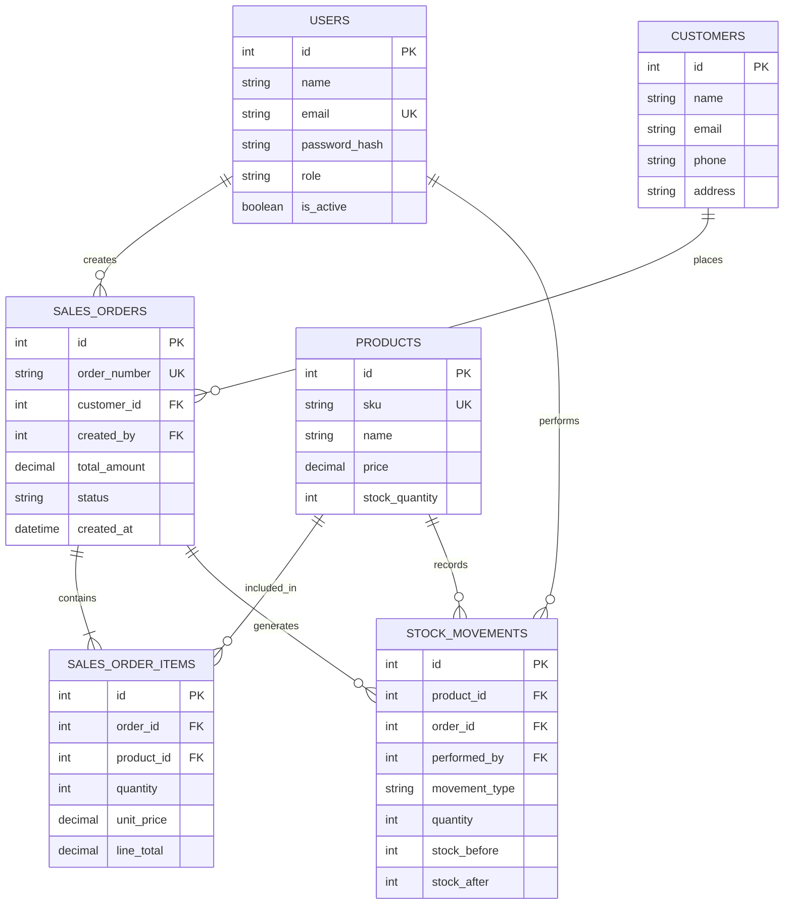

# Sales Order & Inventory Management System

## Database ER Diagram

## Additional fields

- `products.category` stores the product category used by catalogue filters and CSV imports.
- `stock_movements.reason` stores the explanation for each inventory movement. New manual stock adjustments require a reason; system-generated order and opening-stock movements also record their cause.
